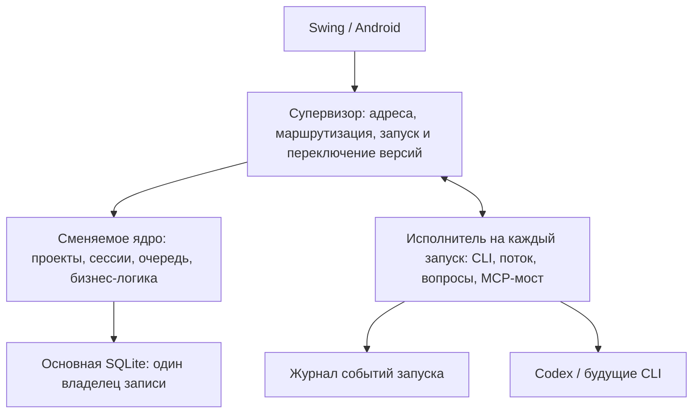

# Горячая замена ядра

Статус: предложение по архитектуре от 2 ноября 2026 года. Нынешнее обновление GUI уже работает без остановки запусков. Описанный ниже протокол замены ядра во время исполнения ещё не реализован.

Цель: обновлять логику проектов, сессий, очереди и API во время ответа агента. Процесс CLI, его текущий turn, вызванные команды и открытый вопрос пользователю продолжают существовать. Допускается короткое ожидание команд интерфейса при переключении; потеря или повторное исполнение команды недопустимы.

## Что сейчас привязано к ядру

- `HostService.running`: отмена, накопленный текст, текущая фаза и активность. `HostService.pending`: незакрытые вопросы и CompletableFuture ответа.
- `HostService.execute`: открывает MCP-сервер, вызывает `SessionRunner`, сохраняет результат и возвращает его родителю.
- `CodexAdapter` / `JsonProcess`: владеют процессом app-server, stdin/stdout, незавершёнными RPC и событиями. Закрытие транспорта останавливает созданные процессы.
- `SessionToolsServer`: содержит прямую ссылку на SessionStore и замыкания HostService. Его адрес и токен переданы живому агенту.
- `HostMain` владеет host.lock; при старте SessionStore помечает все прежние RUNNING как прерванные. Для подключения к пережившим замену исполнителям это поведение потребуется изменить.
- MobileGateway живёт внутри HostService. HostClient повторяет чтения после смены дескриптора; произвольные POST не повторяет, поскольку не у всех есть сохранённые идентификаторы операций.

Поэтому одной заменой host.json нельзя передать текущие запуски новому ядру. Сначала нужно изменить владельца транспорта и состояния исполнения.

## Разделение процессов

**Супервизор** держит стабильные локальные адреса и LAN-подключение, запускает процессы, знает активную версию ядра и поколение управления. Он не хранит логику очереди, проектов или GitHub. Его протокол должен быть маленьким и редко меняться.

**Ядро** хранит доменную модель и очередь в основной SQLite, принимает пользовательские команды, решает, какую работу запустить, и формирует историю. При смене ядра продолжает действовать ограничение: один процесс записывает основную базу. Кандидат проверяется на отдельной согласованной копии.

**Исполнитель запуска** — самостоятельный Java-процесс, который владеет CLI, его потоками, протоколом, отменой и интерактивными вопросами. Он запускается из конкретной неизменяемой сборки и живёт до подтверждённого сохранения результата ядром. Завершение процесса ядра не закрывает исполнителя или его потомков. В основной SQLite исполнитель ничего не пишет.

Адрес MCP для запущенного агента остаётся неизменным: исполнитель держит небольшой мост, который направляет запросы актуальному ядру через супервизор. Новый обработчик `session_spawn` или `artifact_publish` может заработать после замены ядра, сохранив исходный MCP-адрес. Мост передаёт удостоверенную сессию вызывающего агента, а не доверяет projectId из аргументов.

## Протокол исполнителя

- `runId` и `jobId` постоянны. Регистрация содержит PID, время создания процесса, случайный идентификатор экземпляра, путь сборки, версию протокола и удостоверение для локального управления. Одного PID недостаточно из-за его повторного использования ОС.
- События получают возрастающий `sequence` внутри запуска. Исполнитель ведёт журнал вне основной базы и отдаёт события после указанной позиции, включая завершение и текущие вопросы.
- Новое ядро принимает события с повторной доставкой. В одной транзакции оно обновляет историю/состояние и сохранённую позицию `(runId, sequence)`. Повтор финального события не создаёт второй ответ или повторную доставку результата родителю.
- Команды управления и изменяющие MCP-вызовы имеют постоянный `operationId`. Результат сохраняется до подтверждения доставки. Повтор после переключения возвращает прежний результат, не создавая вторую подсессию, задачу или артефакт.
- Запуск `jobId` регистрируется до старта CLI. Повтор команды запуска возвращает существующего исполнителя. При неопределённом результате старта ядро сначала проверяет регистрацию и живой экземпляр, не повторяет работу вслепую.
- Номер поколения управления защищает от запоздалых команд старого ядра. Исполнитель принимает команды только от действующего владельца; передача поколения согласуется супервизором.
- Вопросы и ожидающие ответы принадлежат исполнителю. Новое ядро повторно показывает тот же requestId. Ответ после смены ядра попадает в исходный незавершённый RPC агента.
- Завершённый исполнитель удаляет журнал и выходит только после подтверждения, что финальное событие сохранено. Аварийное завершение исполнителя отличается от замены ядра и обрабатывается как отдельное прерывание.

## Последовательность обновления

1. Собрать версию B в отдельный каталог. Сверить версии протоколов ядра, супервизора и уже работающих исполнителей. Проверить B на копии базы без запуска агентов.
2. Ядро A закрывает приём новых изменений и выдачу новых запусков, завершает уже начатые короткие транзакции. Дожидаться завершения агентов не требуется: исполнители продолжают работу и записывают события.
3. Супервизор закрывает маршрут к A. A освобождает основную базу и блокировку владельца. Запоздалые изменяющие запросы A больше не принимаются.
4. B получает исключительное владение основной базой, сверяет живых исполнителей с сохранёнными jobId/runId, восстанавливает поток с последней подтверждённой позиции и показывает открытые вопросы. Прежний `recoverInterruptedRuns()` заменяется сверкой с реальными исполнителями.
5. После сверки B становится активным получателем команд, а супервизор передаёт ему поколение управления. Только затем включается планирование новых запусков с учётом уже работающих исполнителей и пользовательских пауз.
6. Клиенты повторяют неподтверждённые команды с прежним operationId. Команда считается принятой после её сохранения ядром, а не после попадания в память прокси. Черновики и ожидающие отправки остаются у клиента до подтверждения. Для этого нужно распространить сохранённые receipts на все изменяющие API, включая настольную обычную отправку и создание сессии.
7. После проверки здоровья B процесс A завершается. Если B не проходит проверку, оно освобождает базу, и совместимая A заново подключается к тем же исполнителям и текущей базе.

Откат версии не восстанавливает старый снимок поверх текущей базы: в ней могут уже находиться новые сообщения. Пока нужна возможность отката, изменения схемы остаются добавочными и читаемыми предыдущей версией. Несовместимые обновления используют прежний режим ожидания завершения запусков.

Stop проходит через супервизор к исполнителю даже во время переключения. До отправки отмены супервизор сохраняет небольшой журнал управляющих намерений: operationId, затронутые запуски и требуемую паузу очередей. Это отдельный журнал, не запись в основную SQLite. Перед включением планировщика B переносит эти намерения в основную базу с сохранением receipt и подтверждает их применение. Так между остановкой процесса и установкой паузы не стартует следующее обычное сообщение. Приоритетная правка использует такой же постоянный operationId; изменение ядра не должно повторно отменять уже начатую правку.

## Граница обновления

Проекты, очередь, API и обработчики инструментов получают новую версию при переключении. Уже работающий исполнитель сохраняет свою версию адаптера до конца запуска. Новые запуски получают новый адаптер. Обновление самого супервизора и несовместимый протокол исполнителя — отдельные случаи; первоначально для них сохраняется нынешнее безопасное ожидание.

Первый переход на эту архитектуру потребуется выполнить нынешним механизмом после завершения текущих запусков: существующие stdin/stdout и Java-объекты уже принадлежат старому процессу. Последующие замены ядра смогут обходиться без такого ожидания.

## Первый проверяемый срез

Сначала отдельный стенд с имитатором агента: исполнитель выдаёт пронумерованные события, вызывает инструмент и задаёт вопрос. Ядро A заменяется на B посреди работы; PID исполнителя и идентификатор разговора сохраняются. Затем проверяется настоящий CLI без изменений рабочих проектов.

Обязательные сценарии: замена во время потока и ожидающего ответа; завершение агента в момент переключения; Stop и новая приоритетная задача во время переключения; повтор запуска и MCP-команды после потери ответа; падение B и откат на A; пользовательская пауза и очередь; переключение при подключённом Android. В истории каждый результат появляется ровно один раз, процессы агента продолжаются, новый запуск той же сессии не начинается до завершения прежнего.
